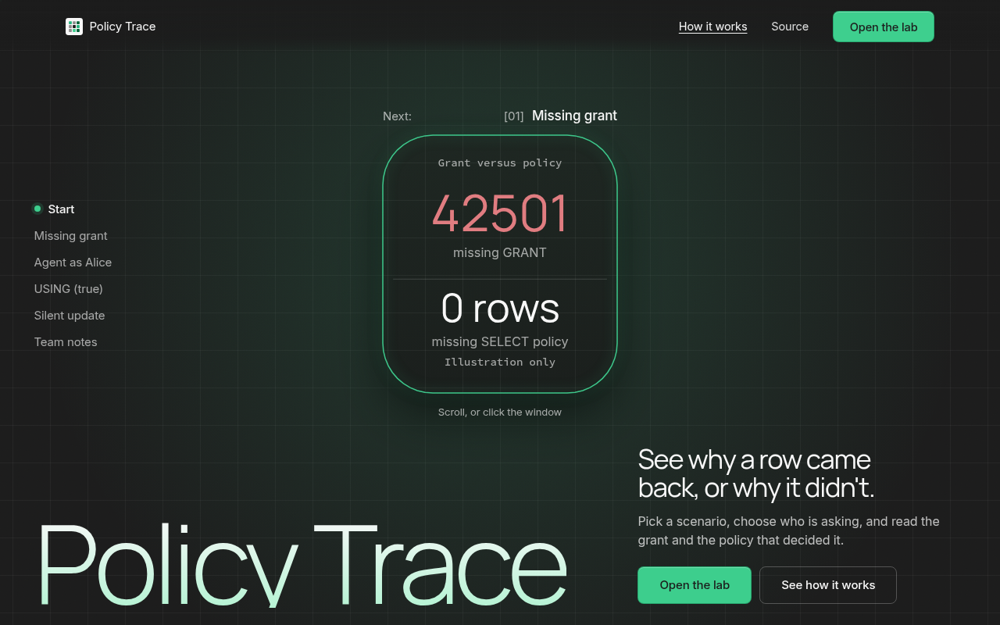

# Policy Trace

A lab that shows whether a Postgres row was stopped by a grant or filtered by a policy.



For reviewers: open [/lab/missing-grant](https://policy-trace-gray.vercel.app/lab/missing-grant) as Alice, which is the default. No signup.

Policy Trace is an independent community project. It is not a Supabase product and it is not affiliated with Supabase Inc.

## Quick links

- Live demo: [https://policy-trace-gray.vercel.app](https://policy-trace-gray.vercel.app)
- Repository: [https://github.com/ohjay-official/policy-trace](https://github.com/ohjay-official/policy-trace)

## Try it in 30 seconds

The lab needs no account. These steps quote the copy on the live site.

1. Open [https://policy-trace-gray.vercel.app/lab/missing-grant](https://policy-trace-gray.vercel.app/lab/missing-grant). Under **Who is running the query**, **Alice** is selected. The **Missing grant** chip is selected. The result kicker is **Grant layer, not policy**. The card shows **42501** and **permission denied for table documents**, with this detail: "The SELECT grant is missing for authenticated. Postgres raised 42501 and did not run the policies. This is the grant layer, not the policy layer."
2. Switch the chip to **Silent empty select**. The kicker becomes **Policy layer**. The result table lists **Q4 plan** and **Hiring notes** as **Filtered**. The trace says: "The query succeeded and raised no error. Row level security filtered every row. An empty result is not a 42501."
3. Switch the chip to **Grant and owner policy**. **Q4 plan** is marked **Returned**. **Hiring notes** is marked **Filtered**. The trace on that hidden row says `USING did not match: ((select auth.uid()) = owner_id)`.

On a phone, open the **Trace · Grant layer, not policy** or **Trace · Policy layer** bar to read the same copy. The two failures look similar in an app that only checks whether any rows came back. They are not the same failure.

## Check that it works

[](https://github.com/ohjay-official/policy-trace/actions/workflows/ci.yml)

The job that checks everything is `verify` in [`.github/workflows/ci.yml`](.github/workflows/ci.yml). It runs `npm run typecheck`, `npm run lint`, `npm test`, `npm run test:sql`, and `npm run build`. A passing `npm test` run prints `Tests  44 passed (44)` and `Test Files  6 passed (6)`.

There is no single npm script that runs that full suite locally. `npm test` is Vitest only. `npm run test:sql` needs a local PostgreSQL server.

## What's new here

Supabase piloted an official RLS Tester preview in the dashboard. It could impersonate a role, run a `SELECT`, and show which policies were evaluated. On 13 July 2026, [supabase/supabase PR 47866](https://github.com/supabase/supabase/pull/47866) removed that preview. The PR says they were "pausing the development of the RLS Tester feature preview while we re-evaluate its direction." Official docs still explain that grants and policies fail in different ways. This lab does not claim to be the only place those layers can be inspected, and it does not replace Studio, Advisors, or the docs.

What changed in 2026 is that a missing grant is louder. Supabase stopped exposing new `public` tables to the Data API automatically. A missing `GRANT` now returns Postgres `42501` ("permission denied") instead of a quiet empty result. The official changelog was [published on 28 April 2026](https://supabase.com/changelog/45329-breaking-change-tables-not-exposed-to-data-and-graphql-api-automatically). The stated timeline was opt-in at project creation from that date, the default for new projects from 30 May 2026, and enforcement on existing projects on 30 October 2026. The changelog is explicit that RLS did not change: grants decide whether a role can reach the table at all, and policies decide which rows that role can see.

A missing `SELECT` policy is still silent. The query succeeds, the grant has already passed, and the result is an empty array with no error. After the default-grant change, the two failures are easier to mix up, because both can look like "the app returned nothing." This lab is a public, shareable place to watch both layers on a real Supabase project, as `anon`, Alice, Bob, an agent signed in as Alice, or `service_role`.

Source notes for the 2026 grant change, the tester removal, and the agent-boundary framing are in [`docs/research/07-verification.md`](docs/research/07-verification.md) and [`docs/research/03-supabase-priorities.md`](docs/research/03-supabase-priorities.md).

## What works today

| Area | Status |
| --- | --- |
| Five seeded labs | Live at [policy-trace-gray.vercel.app](https://policy-trace-gray.vercel.app), with no signup |
| Identities | `anon`, Alice, Bob, Agent as Alice, and `service_role` |
| Trace | Names the grant layer, the policy layer, or an RLS bypass, and shows per-row `USING` / `WITH CHECK` checks |
| Editor | Accepts only policy and grant statements on `lab_sandbox` tables. **Run**, **Copy SQL**, and **Share** are on the lab page |
| Shares | A share stores a read-only snapshot. Fork opens that SQL in the lab |
| URL state | Choosing who is asking, or a policy chip, updates `?as=` and `?chip=` |
| Safety | Every run is a transaction that rolls back. The browser only uses the publishable key |
| Automated checks | 44 Vitest tests, plus SQL evaluator tests, typecheck, lint, and a production build in the `verify` job |

| Limit | Detail |
| --- | --- |
| No film or post yet | There is no published demo recording or X post to link here |
| Fixed identities | You cannot sign in as yourself. Only the five seeded identities are available |
| Whitelisted SQL | The editor rejects anything other than policy and grant statements on the current scenario's `lab_sandbox` tables |
| Timeouts | A statement timeout (Postgres `57014`) is retried once, then the site shows "The database took too long to answer. Run it again." with a **Run again** button |

## Tutorial

<details>
<summary>Walk through the five scenarios, with the SQL and the trace copy</summary>

Every run is a transaction that rolls back. Edits you type are not saved unless you create a share snapshot.

The identities are fixed:

| Who | Postgres role | `auth.uid()` |
| --- | --- | --- |
| anon | `anon` | null |
| Alice | `authenticated` | `11111111-1111-1111-1111-111111111111` |
| Bob | `authenticated` | `22222222-2222-2222-2222-222222222222` |
| Agent as Alice | `authenticated` | Alice's id, with `app_metadata.agent = true` |
| service_role | `service_role` | null, and the role bypasses row level security |

`service_role` is on the switch so the bypass is visible. When that identity is selected, the screen shows: "service_role bypasses row level security. Policies do not run for this role. A secret key in a browser can read every row the grants allow. This lab never asks for that key." The browser only ever uses the publishable key. There is no field for a secret key.

### 1. Missing grant

Open `/lab/missing-grant` as Alice. The default SQL is the owner policy with no grant:

```sql
alter table lab_sandbox.documents enable row level security;

create policy "owner reads own documents"
on lab_sandbox.documents
as permissive
for select
to authenticated
using ((select auth.uid()) = owner_id);
```

The result kicker is **Grant layer, not policy**. The card shows **42501** and **permission denied for table documents**. The detail is that the `SELECT` grant is missing for `authenticated`, so Postgres did not run the policies. The per-row trace is still drawn: Alice's "Q4 plan" shows `USING matched`, and Bob's "Hiring notes" shows `USING did not match`, with the note that the grant check failed first.

**Silent empty select** is the other half of the comparison:

```sql
alter table lab_sandbox.documents enable row level security;

grant select on lab_sandbox.documents to authenticated;
```

`sqlstate` is null. The query succeeds and returns no rows. The kicker is **Policy layer**. The result table lists both rows as **Filtered**. The trace detail is "The query succeeded and raised no error. Row level security filtered every row. An empty result is not a 42501." There are no policies, so the per-row policy checks are empty.

**Grant and owner policy** adds both layers. Alice gets "Q4 plan" only, marked **Returned**. The hidden row, "Hiring notes," is marked **Filtered**, and its trace says `USING did not match`.

### 2. Agent as Alice

Open `/lab/agent-as-alice`. The scenario query is the `list_tasks` tool. The agent does not get a special Postgres role. It runs as Alice, with Alice's JWT, which is the same framing as [Supabase's 22 October 2026 post](https://supabase.com/blog/give-your-supabase-app-its-own-mcp-server): "your RLS policies decide what each agent can reach."

The default owner policy:

```sql
alter table lab_sandbox.tasks enable row level security;

grant select on lab_sandbox.tasks to authenticated;

create policy "owners read their tasks"
on lab_sandbox.tasks
as permissive
for select
to authenticated
using ((select auth.uid()) = owner_id);
```

As Agent as Alice, "Ship the grant fix" and "Record the demo" are marked **Returned**. Bob's "Review the hiring notes" is marked **Filtered**, and its trace says `USING did not match`.

**Add USING (true)** places a second permissive policy next to the owner policy. Permissive policies combine with `OR`, so the agent can now read every task, including Bob's.

### 3. USING (true)

Open `/lab/using-true` as Alice. Invoices carry a `secret`. The owner policy alone keeps Bob's invoice away from Alice. "Studio invoice" is marked **Returned**. "Retreat invoice" is marked **Filtered**.

**Add USING (true)** leaves the owner policy in place and adds a policy that matches every row:

```sql
alter table lab_sandbox.invoices enable row level security;

grant select on lab_sandbox.invoices to authenticated;

create policy "owners read their invoices"
on lab_sandbox.invoices
as permissive
for select
to authenticated
using ((select auth.uid()) = owner_id);

create policy "authenticated reads every invoice"
on lab_sandbox.invoices
as permissive
for select
to authenticated
using (true);
```

Both invoices are then marked **Returned**, including Bob's secret (`visa 4000`). The trace on Bob's row shows the owner policy's `USING` as false and the `USING (true)` policy as true. One permissive `USING (true)` is enough to leak the row.

### 4. Silent update

Open `/lab/silent-update` as Alice. The scenario statement is:

```sql
update lab_sandbox.tickets
set status = 'closed'
where owner_id = (select auth.uid())
returning id, title, owner_id, status;
```

**Update policy only** grants `SELECT` and `UPDATE`, but only defines an `UPDATE` policy:

```sql
alter table lab_sandbox.tickets enable row level security;

grant select, update on lab_sandbox.tickets to authenticated;

create policy "owners update their tickets"
on lab_sandbox.tickets
as permissive
for update
to authenticated
using ((select auth.uid()) = owner_id)
with check ((select auth.uid()) = owner_id);
```

The statement raises no error. `rowsAffected` is 0, and `RETURNING` is empty. The kicker is **Policy layer**. The trace detail is: "The statement raised no error. An UPDATE has to read the existing row, and without a SELECT policy that row is not visible, so the update matches nothing." On Alice's "Login bug," the row is marked **Filtered**, and `USING` and `WITH CHECK` both evaluate true. On Bob's "Billing question," the row is marked **Outside the query**, and both checks are false. The policy for the write is not enough by itself.

**Add a SELECT policy** is the repair:

```sql
alter table lab_sandbox.tickets enable row level security;

grant select, update on lab_sandbox.tickets to authenticated;

create policy "owners read their tickets"
on lab_sandbox.tickets
as permissive
for select
to authenticated
using ((select auth.uid()) = owner_id);

create policy "owners update their tickets"
on lab_sandbox.tickets
as permissive
for update
to authenticated
using ((select auth.uid()) = owner_id)
with check ((select auth.uid()) = owner_id);
```

Alice's run marks "Login bug" **Updated**, with `status` `closed` in the Fields column. Bob still cannot close Alice's ticket.

**Revoke UPDATE** leaves the `SELECT` policy in place and drops the `UPDATE` grant. The same statement stops at `42501` (`permission denied for table tickets`) before either policy can apply. That is the grant layer again.

### 5. Team notes

Open `/lab/team-notes` as Alice. A note is visible to its owner, or to a member of its team. Membership lives on `lab_sandbox.team_members`, which has its own `SELECT` policy, because the notes policy reads that table.

```sql
alter table lab_sandbox.notes enable row level security;
alter table lab_sandbox.team_members enable row level security;

grant select on lab_sandbox.notes to authenticated;
grant select on lab_sandbox.team_members to authenticated;

create policy "read own membership"
on lab_sandbox.team_members
as permissive
for select
to authenticated
using ((select auth.uid()) = user_id);

create policy "owner or teammate reads notes"
on lab_sandbox.notes
as permissive
for select
to authenticated
using (
  owner_id = (select auth.uid())
  or team_id in (
    select m.team_id
    from lab_sandbox.team_members m
    where m.user_id = (select auth.uid())
  )
);
```

Alice gets **Returned** on her private "Grocery list," her Acme "Sprint plan," and Bob's Acme "Launch checklist." Bob's private "1:1 notes" and Carol's "Roadmap" on the other team are marked **Filtered**. As Bob, the **Returned** set is "Sprint plan," "1:1 notes," and "Launch checklist."

**Owner only** drops the team check, so Alice no longer sees Bob's Acme note. **USING (true)** on the notes policy exposes Carol's roadmap.

Copy SQL when the editor shows the version you want to keep. Share writes a read-only snapshot. Fork opens that SQL in the lab.

</details>

## How the evaluator stays safe

<details>
<summary>SECURITY DEFINER run_lab, the statement whitelist, rollback, and no service_role key on the client</summary>

`public.run_lab` is a `SECURITY DEFINER` function. The site calls it with the publishable key. It does not execute the text from the editor as written, and the client never receives a `service_role` key.

1. The text is limited to 8000 characters and tokenized.
2. The only accepted statements are `CREATE POLICY`, `DROP POLICY`, `ALTER TABLE ... ENABLE/DISABLE ROW LEVEL SECURITY`, `GRANT`, and `REVOKE`, and only on `lab_sandbox` tables that belong to the current scenario. `DROP TABLE` and a target outside `lab_sandbox` are rejected.
3. Expressions may use columns, literals, `auth.uid()`, and `auth.jwt()`, plus a single-level `EXISTS` or `IN (SELECT ...)` against `lab_sandbox`. Other functions and schemas are rejected.
4. The function executes the canonical SQL it emitted, then runs the scenario query.
5. Postgres will not `SET ROLE` inside a security definer function. The query and the per-row `USING` / `WITH CHECK` checks run in a second security definer function owned by `anon`, `authenticated`, or `service_role`, so grants and policies apply as that role.
6. The function raises a private exception and the subtransaction rolls back. Sandbox tables and policies do not survive the call.

`lab_internal` is not an API schema. `public.labs` and `public.lab_shares` have row level security and no policies for the client roles. Snapshots are read with `get_lab_share(id)`.

The evaluator also has to satisfy pg-safeupdate, which PostgREST loads on the Data API. An `UPDATE` used to copy ticket status into a trace table needed a `WHERE` clause (`WHERE true`). That patch is `supabase/migrations/20261112120300_safeupdate_where.sql`.

</details>

## Run it locally

<details>
<summary>Environment, migrations, and the commands in package.json</summary>

The app is Next.js 15 on the App Router, with Tailwind and the Supabase JS client.

```bash
cp .env.example .env.local
```

Set these two variables in `.env.local`. Do not put a secret key or a `service_role` key in that file, or in any `NEXT_PUBLIC_` variable:

| Name | Value |
| --- | --- |
| `NEXT_PUBLIC_SUPABASE_URL` | `https://<project-ref>.supabase.co` |
| `NEXT_PUBLIC_SUPABASE_ANON_KEY` | The publishable key (`sb_publishable_...`) |

The site builds and renders when they are unset. Run then shows a configuration notice instead of calling the API. Next.js inlines `NEXT_PUBLIC_` variables at build time, so a Vercel deployment needs them present for the build, not only at runtime. Do not commit `.env.local` with a real key.

Apply the migrations, in this order, on a fresh Supabase database. `supabase db push` does that. You can also paste each file into the SQL editor.

1. `supabase/migrations/20261112120000_schemas_tables.sql`
2. `supabase/migrations/20261112120100_evaluator.sql`
3. `supabase/migrations/20261112120200_seed_scenarios.sql`
4. `supabase/migrations/20261112120300_safeupdate_where.sql`

They are written so a second apply does not fail: tables use `if not exists`, policies are dropped before they are created, functions are replaced, and the seed upserts.

The evaluator migration temporarily grants `CREATE` on `lab_internal` so a non-superuser `postgres` role can give the role-specific functions to `anon`, `authenticated`, and `service_role`, then revokes that grant. Those roles have no privileges on `lab_internal` when the migration finishes.

If a project already applied the first three files, it only needs the fourth file.

Do not run `supabase/tests/prelude.sql` on a Supabase project. That file replaces `auth.uid()` for vanilla Postgres. Supabase already provides `auth.uid()` and `auth.jwt()`.

`supabase/seed.sql` repeats the catalog for `supabase db reset`, which runs migrations and then the seed. Keep `lab_sandbox` out of the Data API exposed schemas. Tables there exist only inside the rolled-back transaction. `supabase/config.toml` already omits that schema from `api.schemas`.

```bash
npm install
npm run dev
```

The checks that exist in `package.json` are:

```bash
npm test
npm run typecheck
npm run lint
npm run build
npm run test:sql
```

`npm test` is Vitest, and it covers the browser copy of the whitelist, the trace wording, share-load errors, lab URL state, FAQ accordion behavior, and statement-timeout handling. `npm run test:sql` needs a local PostgreSQL server. It creates and drops a database named `policy_trace_test`, applies the four migrations twice as a non-superuser role that resembles hosted `postgres`, then runs `supabase/tests/prelude.sql` and `supabase/tests/evaluator.sql` against that local database only. Set `DATABASE_URL` to an admin database, or rely on local peer auth for the `postgres` user.

</details>

## How it was built

The first commit is [7f4880b](https://github.com/ohjay-official/policy-trace/commit/7f4880b28ac3d04147e797fe228056f6dfb38866), "docs: research pack, brief and spec," on 12 November 2026 at 16:07 Africa/Lagos (WAT, UTC+1).

The code was written with AI via Cursor cloud agents.

Libraries and services, with versions taken from `package.json`:

| Library or service | Version |
| --- | --- |
| next | ^15.5.6 |
| react, react-dom | ^19.2.0 |
| @supabase/supabase-js | ^2.81.1 |
| lucide-react | ^1.73.0 |
| @fontsource/inter | ^5.3.0 |
| @fontsource/manrope | ^5.3.0 |
| @fontsource/source-code-pro | ^5.3.1 |
| tailwindcss | ^4.1.16 |
| typescript | ^5.9.3 |
| vitest | ^3.2.4 |
| eslint | ^9.39.1 |
| eslint-config-next | ^15.5.6 |
| Hosted database | Supabase Postgres |
| Hosting | Vercel |
| CI | GitHub Actions (`verify` job, postgres:17) |

## License

This project is licensed under the MIT License. See [LICENSE](LICENSE).

## Affiliation

Policy Trace is an independent community project. It is not a Supabase product and it is not affiliated with Supabase Inc. Supabase and the Supabase logo are trademarks of Supabase Inc. The logo files in `public/brand/` are the official assets from the [brand page](https://supabase.com/brand), unmodified, and they appear only next to the "Built on" line. The type stack (Manrope, Inter, Source Code Pro) follows the official dashboard design system, not the brand page, which does not name typefaces.

## Credit

Built by [ohjay-official](https://github.com/ohjay-official). The source is [github.com/ohjay-official/policy-trace](https://github.com/ohjay-official/policy-trace).
