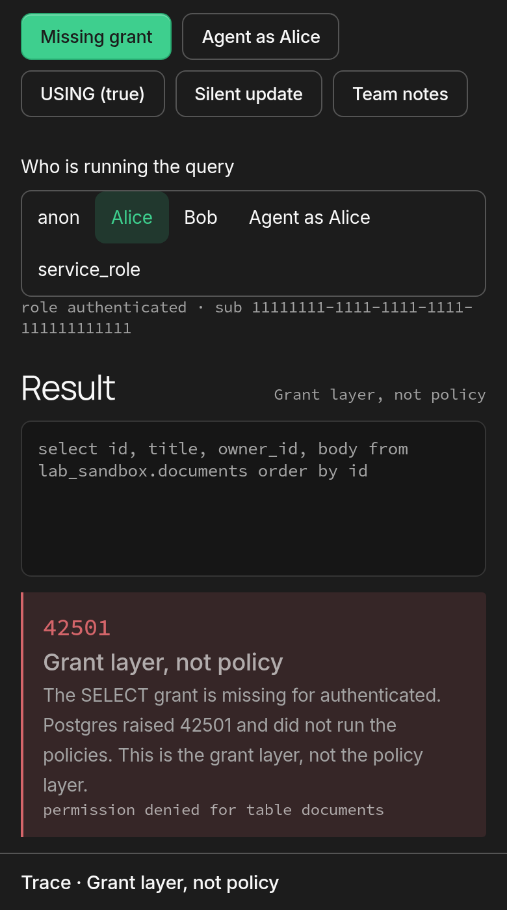
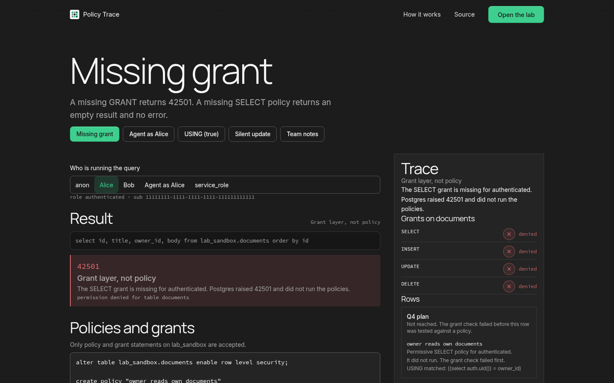
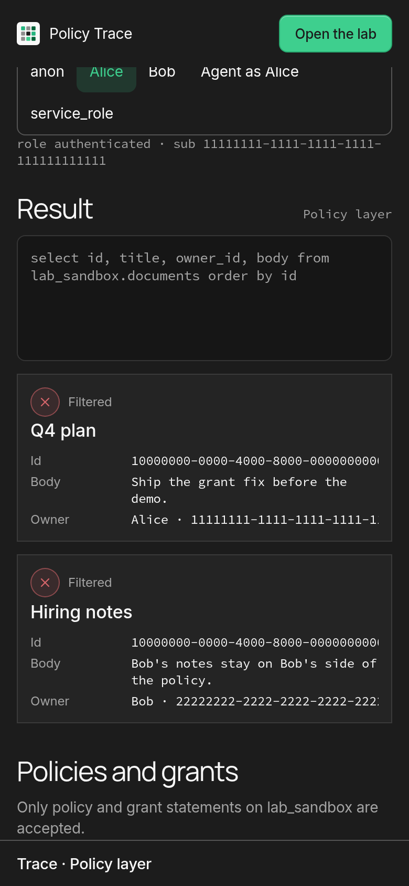
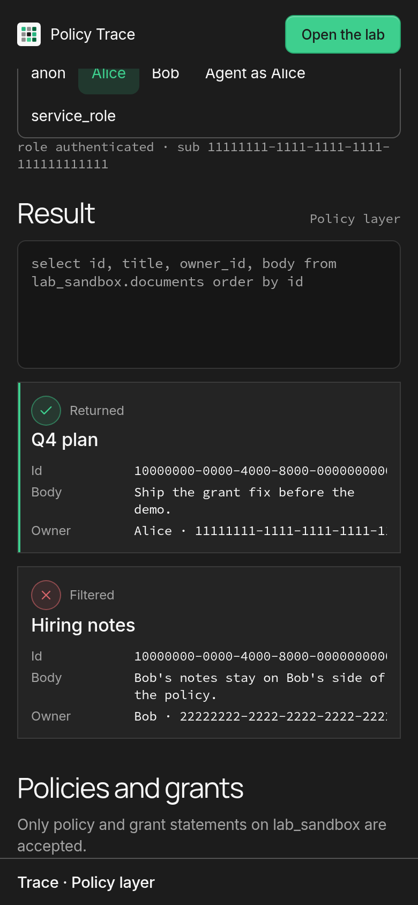
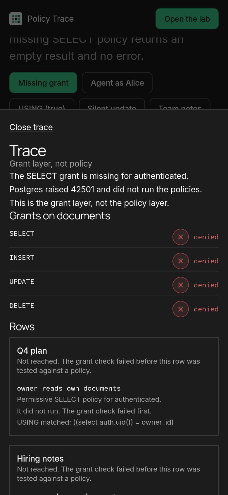

# Policy Trace

<p align="center"></p>

**See whether a Postgres row was stopped by a grant or filtered by a policy.**

A missing GRANT now fails with Postgres 42501, and a missing SELECT policy still returns an empty result with no error. Both can look like "the app returned nothing." Policy Trace is a lab on a real Supabase project: you pick a scenario, switch who you are, and the trace names the layer that decided each row.

Policy Trace is an independent community project. It is not a Supabase product and it is not affiliated with Supabase Inc.

- **Try it, no signup:** [https://policy-trace-gray.vercel.app/lab/missing-grant](https://policy-trace-gray.vercel.app/lab/missing-grant) ([steps](#try-it))
- **Live site:** [https://policy-trace-gray.vercel.app](https://policy-trace-gray.vercel.app)
- **Walk through all five labs:** [Tutorial](#tutorial)
- **Check the tests:** `npm test` ([More ways to test](#more-ways-to-test))

## Try It

The live lab at [https://policy-trace-gray.vercel.app/lab/missing-grant](https://policy-trace-gray.vercel.app/lab/missing-grant). No signup and no account. These steps use the copy on the live site.

1. **Open the link.** Under **Who is running the query**, **Alice** is selected. The **Missing grant** chip is selected. The result kicker is **Grant layer, not policy**. The card shows **42501** and **permission denied for table documents**, with this detail: "The SELECT grant is missing for authenticated. Postgres raised 42501 and did not run the policies."
2. **Switch the chip to Silent empty select.** The kicker becomes **Policy layer**. The result table lists **Q4 plan** and **Hiring notes** as **Filtered**. The trace says: "The query succeeded and raised no error. Row level security filtered every row. An empty result is not a 42501."
3. **Switch the chip to Grant and owner policy.** **Q4 plan** is marked **Returned**. **Hiring notes** is marked **Filtered**. The trace on that hidden row says `USING did not match: ((select auth.uid()) = owner_id)`.

On a phone, open the **Trace · Grant layer, not policy** or **Trace · Policy layer** bar to read the same copy. The two failures look similar in an app that only checks whether any rows came back. They are not the same failure.

## Proof It's Real

[](https://github.com/ohjay-official/policy-trace/actions/workflows/ci.yml)

- The lab is live at [policy-trace-gray.vercel.app](https://policy-trace-gray.vercel.app), with no signup.
- The `verify` job on [`.github/workflows/ci.yml`](.github/workflows/ci.yml) passed on `4d3c003`: [run 43701935852](https://github.com/ohjay-official/policy-trace/actions/runs/43701935852). It runs `npm run typecheck`, `npm run lint`, `npm test`, `npm run test:sql`, and `npm run build`.
- `npm test` is 44 Vitest tests in 6 files. A passing run prints `Tests  44 passed (44)` and `Test Files  6 passed (6)`.
- A 150-run matrix against the hosted database was recorded on 15 November 2026 in Africa/Lagos (UTC+1): 5 labs × 3 chips × 5 identities, on mobile and on desktop. Every row has an empty `problems` list, and each UI kicker matches the RPC `sqlstate`. Results: [mobile](docs/qa/r2-labs-results-mobile.json), [desktop](docs/qa/r2-labs-results-desktop.json), [what the files contain](docs/qa/README.md).
- The project is licensed under MIT. See [LICENSE](LICENSE).

## What's New Here

**A public lab that names the layer, grant or policy, after a missing grant started failing loudly in 2026.**

Official docs already explain that grants and policies fail in different ways. What changed in 2026 is that a missing grant is louder, so the two failures are easier to mix up, including for agents acting on someone's behalf.

- **A missing grant now returns 42501.** Supabase stopped exposing new `public` tables to the Data API automatically. A missing `GRANT` returns Postgres `42501` ("permission denied") instead of a quiet empty result. The official changelog was [published on 28 April 2026](https://supabase.com/changelog/45329-breaking-change-tables-not-exposed-to-data-and-graphql-api-automatically). The stated timeline was opt-in at project creation from that date, the default for new projects from 30 May 2026, and enforcement on existing projects on 30 October 2026. The changelog is explicit that RLS did not change.
- **A missing SELECT policy is still silent.** The query succeeds, the grant has already passed, and the result is an empty array with no error.
- **The trace names the layer, per row.** It shows whether the run stopped at the grant, was filtered by a policy, or bypassed RLS, and it shows the per-row `USING` / `WITH CHECK` checks.
- **An agent runs as the signed-in user.** The Agent as Alice lab uses the same framing as [Supabase's 22 October 2026 post](https://supabase.com/blog/give-your-supabase-app-its-own-mcp-server): "your RLS policies decide what each agent can reach." There is no separate agent role.
- **It does not replace Studio, Advisors, or the docs.** Supabase piloted an official RLS Tester preview in the dashboard. On 13 July 2026, [supabase/supabase PR 47866](https://github.com/supabase/supabase/pull/47866) removed that preview, "pausing the development of the RLS Tester feature preview while we re-evaluate its direction." This lab does not claim to be the only place those layers can be inspected.

Source notes are in [`docs/research/07-verification.md`](docs/research/07-verification.md) and [`docs/research/03-supabase-priorities.md`](docs/research/03-supabase-priorities.md).

## What Works Today

| Piece | State |
| --- | --- |
| Five seeded labs | Live at [policy-trace-gray.vercel.app](https://policy-trace-gray.vercel.app), with no signup: Missing grant, Agent as Alice, USING (true), Silent update, and Team notes |
| Identities | `anon`, Alice, Bob, Agent as Alice, and `service_role` |
| Trace | Names the grant layer, the policy layer, or an RLS bypass, and shows per-row `USING` / `WITH CHECK` checks |
| Editor | Accepts only policy and grant statements on `lab_sandbox` tables. **Run**, **Copy SQL**, and **Share** are on the lab page |
| Shares | A share stores a read-only snapshot. **Fork this** opens that SQL in the lab |
| URL state | Choosing who is asking, or a policy chip, updates `?as=` and `?chip=` |
| Safety | Every run is a transaction that rolls back. The browser only uses the publishable key |
| Automated checks | 44 Vitest tests, plus SQL evaluator tests, typecheck, lint, and a production build in the `verify` job |

| Limit | Detail |
| --- | --- |
| No film or post yet | There is no published demo recording or X post to link here |
| Fixed identities | You cannot sign in as yourself. Only the five seeded identities are available |
| Whitelisted SQL | The editor rejects anything other than policy and grant statements on the current scenario's `lab_sandbox` tables |
| Timeouts | A statement timeout (Postgres `57014`) is retried once, then the site shows "The database took too long to answer. Run it again." with a **Run again** button |

## More Ways to Test

From quickest to most real. The unit tests and the app checks do not need a Supabase account.

<details>
<summary><strong>1. The unit tests (44 tests, needs Node and <code>npm install</code>)</strong></summary>

```bash
npm install
npm test
```

A passing run prints `Tests  44 passed (44)` and `Test Files  6 passed (6)`. The six files cover the browser copy of the whitelist (including 14 rejection cases), the trace wording (including the RETURNING-fields fix), share-load errors, lab URL state, FAQ accordion behavior, and statement-timeout handling.

</details>

<details>
<summary><strong>2. The CI checks, locally (Node 22; <code>test:sql</code> needs a local PostgreSQL server)</strong></summary>

There is no single npm script that runs the full `verify` suite locally. CI uses Node 22 and a Postgres 17 service with pg-safeupdate loaded. Locally:

```bash
npm install
npm run typecheck
npm run lint
npm test
npm run test:sql
npm run build
```

`npm run test:sql` creates and drops a database named `policy_trace_test`, applies the first four migrations twice as a non-superuser role that resembles hosted `postgres`, then runs `supabase/tests/prelude.sql` and `supabase/tests/evaluator.sql` against that local database only. Set `DATABASE_URL` to an admin database, or rely on local peer auth for the `postgres` user.

The fifth migration, `supabase/migrations/20261115110000_index_foreign_keys.sql`, only adds indexes. It is not applied by `npm run test:sql`.

Do not run `supabase/tests/prelude.sql` on a Supabase project. That file replaces `auth.uid()` for vanilla Postgres. Supabase already provides `auth.uid()` and `auth.jwt()`.

</details>

<details>
<summary><strong>3. Run your own Supabase project (needs a project and the publishable key)</strong></summary>

The commands, the five migrations, and the environment variables are in [Run your own](#run-your-own). Use the publishable key only. Never put a secret key or a `service_role` key in a `NEXT_PUBLIC_` variable.

</details>

## Screenshots

The shots below are of the live lab at [policy-trace-gray.vercel.app](https://policy-trace-gray.vercel.app), captured on 16 November 2026.

<p align="center"></p>

<p align="center">



</p>

## Tutorial

The five labs, with the SQL and the trace copy, are in [`docs/tutorial.md`](docs/tutorial.md). Start at [/lab/missing-grant](https://policy-trace-gray.vercel.app/lab/missing-grant).

## How the evaluator works

`public.run_lab` is a `SECURITY DEFINER` function. The site calls it with the publishable key. It does not execute the text from the editor as written, and the client never receives a `service_role` key.

1. The text is limited to 8000 characters and tokenized.
2. The only accepted statements are `CREATE POLICY`, `DROP POLICY`, `ALTER TABLE ... ENABLE/DISABLE ROW LEVEL SECURITY`, `GRANT`, and `REVOKE`, and only on `lab_sandbox` tables that belong to the current scenario. `DROP TABLE` and a target outside `lab_sandbox` are rejected.
3. Expressions may use columns, literals, `auth.uid()`, and `auth.jwt()`, plus a single-level `EXISTS` or `IN (SELECT ...)` against `lab_sandbox`. Other functions and schemas are rejected.
4. The function executes the canonical SQL it emitted, then runs the scenario query.
5. Postgres will not `SET ROLE` inside a security definer function. The query and the per-row `USING` / `WITH CHECK` checks run in a second security definer function owned by `anon`, `authenticated`, or `service_role`, so grants and policies apply as that role.
6. The function raises a private exception and the subtransaction rolls back. Sandbox tables and policies do not survive the call.

`lab_internal` is not an API schema. `public.labs` and `public.lab_shares` have row level security and no policies for the client roles. Snapshots are read with `get_lab_share(id)`.

The evaluator also has to satisfy pg-safeupdate, which PostgREST loads on the Data API. An `UPDATE` used to copy ticket status into a trace table needed a `WHERE` clause (`WHERE true`). That patch is `supabase/migrations/20261112120300_safeupdate_where.sql`.

## Security

- **The browser only uses the publishable key.** There is no field for a secret key or a `service_role` key. When **service_role** is selected, the screen says so, and the role-owned function is what applies that role on the server.
- **The editor does not run arbitrary SQL.** The whitelist above is the only path into `run_lab`. The same checks are covered in the Vitest whitelist tests and in `supabase/tests/evaluator.sql`.
- **Every run rolls back.** Sandbox tables and policies do not survive the call.

**What it doesn't promise.** This is a teaching lab on fixed, seeded data, not a policy debugger for your own project. You cannot sign in as yourself or point it at your own tables. A share is a read-only SQL snapshot, not a live session. Vercel hosts the site and Supabase hosts the database; both can see the traffic the lab sends. The project is independent and is not a substitute for Studio, Advisors, or a review of your own policies.

## Run your own

The app is Next.js 15 on the App Router, with Tailwind and the Supabase JS client.

```bash
cp .env.example .env.local
```

Set these two variables in `.env.local`. Do not put a secret key or a `service_role` key in that file, or in any `NEXT_PUBLIC_` variable:

| Name | Value |
| --- | --- |
| `NEXT_PUBLIC_SUPABASE_URL` | `https://<project-ref>.supabase.co` |
| `NEXT_PUBLIC_SUPABASE_ANON_KEY` | `<publishable-key>` |

The site builds and renders when they are unset. **Run** then shows a configuration notice instead of calling the API. Next.js inlines `NEXT_PUBLIC_` variables at build time, so a Vercel deployment needs them present for the build, not only at runtime. Do not commit `.env.local` with a real key.

Apply the migrations, in this order, on a fresh Supabase database. `supabase db push` does that. You can also paste each file into the SQL editor.

1. `supabase/migrations/20261112120000_schemas_tables.sql`
2. `supabase/migrations/20261112120100_evaluator.sql`
3. `supabase/migrations/20261112120200_seed_scenarios.sql`
4. `supabase/migrations/20261112120300_safeupdate_where.sql`
5. `supabase/migrations/20261115110000_index_foreign_keys.sql`

They are written so a second apply does not fail: tables use `if not exists`, policies are dropped before they are created, functions are replaced, the seed upserts, and the indexes use `if not exists`. If a project already applied the first four files, it only needs the fifth.

The evaluator migration temporarily grants `CREATE` on `lab_internal` so a non-superuser `postgres` role can give the role-specific functions to `anon`, `authenticated`, and `service_role`, then revokes that grant. Those roles have no privileges on `lab_internal` when the migration finishes.

`supabase/seed.sql` repeats the catalog for `supabase db reset`, which runs migrations and then the seed. Keep `lab_sandbox` out of the Data API exposed schemas. Tables there exist only inside the rolled-back transaction. `supabase/config.toml` already omits that schema from `api.schemas`.

```bash
npm install
npm run dev
```

## Repository

| Path | What it holds |
| --- | --- |
| `src/` | Next.js App Router app, the lab UI, and the browser whitelist and trace |
| `supabase/migrations/` | The five migrations, including the evaluator and the seed |
| `supabase/tests/` | SQL evaluator tests, used by `npm run test:sql` |
| `scripts/test-sql.sh` | Creates `policy_trace_test`, applies the first four migrations twice, runs the SQL tests |
| `docs/tutorial.md` | Walk through the five labs, with the SQL and the trace copy |
| `docs/qa/` | The 150-run matrix results from 15 November 2026 |
| `docs/research/` | Source notes for the 2026 grant change, the tester removal, and the role |
| `docs/demo-script.md` | A shot list for recording the live site |
| `.github/workflows/ci.yml` | The `verify` job |

## Built With

The code, tests and docs were written with AI, directed by Oh-Jay.

Libraries and services, at the versions `package-lock.json` pins:

- **Runtime:** Next.js 15.5.29, React 19.3.1, `react-dom` 19.3.1, `@supabase/supabase-js` 2.119.0, `lucide-react` 1.73.0. Fonts: Inter 5.3.0, Manrope 5.3.0, Source Code Pro 5.3.1 (`@fontsource/*`).
- **Development only:** Tailwind CSS 4.3.5, TypeScript 5.9.3, Vitest 3.2.7, ESLint 9.39.5, `eslint-config-next` 15.5.29, `@tailwindcss/postcss` 4.3.5, `@types/node` 22.20.5, `@types/react` 19.3.0, `@types/react-dom` 19.3.0, `@eslint/eslintrc` 3.3.7.
- **Services:** Supabase Postgres, Vercel, GitHub Actions (`verify` job, `postgres:17`).

## License

This project is licensed under the MIT License. See [LICENSE](LICENSE). Copyright (c) 2026 Oh-Jay (ohjay-official).

Policy Trace is an independent community project. It is not a Supabase product and it is not affiliated with Supabase Inc. Supabase and the Supabase logo are trademarks of Supabase Inc. The logo files in `public/brand/` are the official assets from the [brand page](https://supabase.com/brand), unmodified, and they appear only next to the "Built on" line. The type stack (Manrope, Inter, Source Code Pro) follows the official dashboard design system, not the brand page, which does not name typefaces.

Built by [ohjay-official](https://github.com/ohjay-official). The source is [github.com/ohjay-official/policy-trace](https://github.com/ohjay-official/policy-trace).
